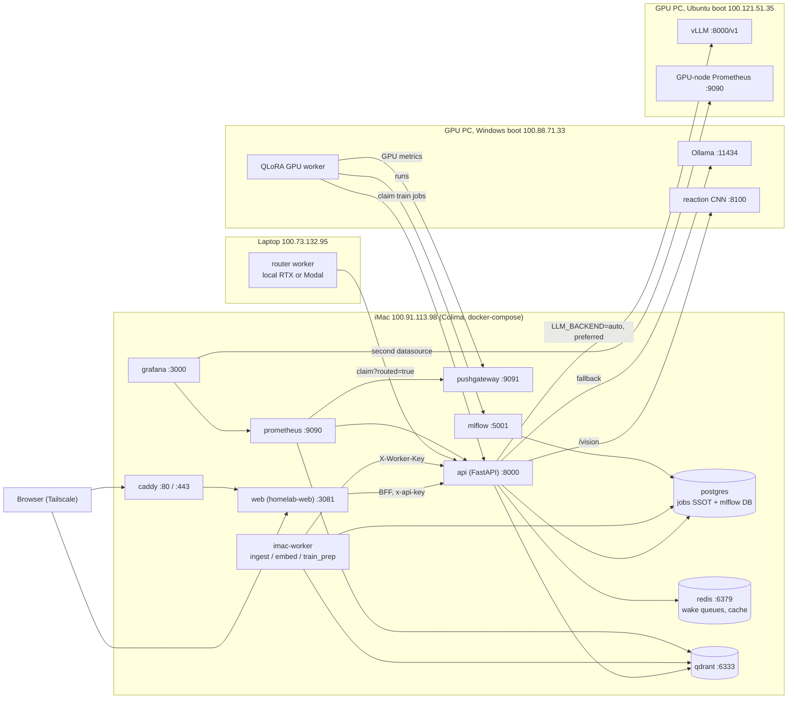

<div align="center">

# homelab-services

**The iMac control plane: API gateway, Postgres job queue, RAG, web UI hosting and monitoring for the homelab, run with Docker Compose on Colima.**

[](https://github.com/zakiscoding/homelab-services/actions/workflows/ci.yml)     

[homelab](https://github.com/zakiscoding/homelab) (docs hub) · **homelab-services** · [homelab-web](https://github.com/zakiscoding/homelab-web) · [homelab-gpu](https://github.com/zakiscoding/homelab-gpu) · [gpu-systems-lab](https://github.com/zakiscoding/gpu-systems-lab)

</div>

---

## What's inside

- **FastAPI gateway** (`api/`, :8000): chat, RAG, vision proxy, job queue and the worker API. Every endpoint is in [docs/API.md](docs/API.md).
- **Postgres job queue**: Postgres is the single source of truth for jobs, with leases, retries and priorities. Redis only sends wake signals. See [docs/JOBS.md](docs/JOBS.md).
- **RAG**: the iMac worker chunks and embeds documents (fastembed, CPU) into Qdrant. `/rag/query` retrieves from Qdrant and answers with the LLM.
- **LLM routing**: with `LLM_BACKEND=auto`, chat uses vLLM on the GPU PC's Ubuntu boot when it is up and falls back to Ollama on its Windows boot.
- **Observability**: the homelab's central Prometheus and Grafana. Prometheus scrapes this stack and, over the tailnet, the GPU PC (its local Prometheus via `/federate`, plus vLLM on either boot) and [GopherGrid](https://github.com/zakiscoding/gophergrid)'s schedulers and workers. Four dashboards are [public and read-only](#public-dashboards).
- **MLflow** (:5001): experiment tracking, backed by the Postgres `mlflow` database.

## Architecture



The GPU PC dual-boots, so only one of the Windows or Ubuntu groups is online at a time. The
central Prometheus scrapes both boots' addresses, so GPU panels work in either one.

## Quickstart

On the iMac (macOS, Apple M1). Prerequisites: `brew install colima docker docker-compose`, the
1TB drive mounted at `/Volumes/1tb drive`, and `homelab-web` cloned next to this repo (it is the
`web` build context).

```bash
cd "/Volumes/1tb drive/homelab-services"
./scripts/ensure-homelab-web.sh        # clone ../homelab-web if missing
./scripts/bootstrap-env.sh             # create .env with random secrets (skips if .env exists)
./scripts/setup-1tb.sh                 # first time only: data dirs + Colima VM on the 1TB drive
./scripts/start-stack.sh               # start Colima if needed, build and start every service
bash scripts/migrate-all.sh            # back up Postgres, apply postgres/0*.sql migrations
```

Then open http://100.91.113.98:3081 (web UI) and http://100.91.113.98:3000 (Grafana).

On the Windows laptop, create a `.env` for local work with `.\scripts\bootstrap-env.ps1`.

## Public dashboards

**https://grafana-proxy.vllm-gateway.workers.dev** lists four read-only dashboards anyone can open
or link to: Homelab overview, Homelab stack, GPU PC (RTX 5070) and GopherGrid.

```
browser → grafana-proxy Worker (workers.dev) → Workers VPC Service → tunnel "mos-imac" → grafana:3000
```

- No router ports are open. `cloudflare/compose.yml` runs `cloudflared`, which only connects out.
- Each dashboard is a Grafana *public dashboard* link: it runs only that dashboard's saved
  queries. The Worker ([`grafana-proxy`](https://github.com/zakiscoding/gpu-systems-lab/tree/main/grafana-proxy)
  in gpu-systems-lab) forwards only those dashboards and Grafana's static files. Login, the
  admin UI, the API, Explore and datasource proxies return 404, and no cookies pass through.
- Public dashboards don't support template variables, so the shared dashboards have none.
- To share another dashboard: in Grafana, **Share → Share externally**, then add its access
  token to `PUBLIC_DASHBOARDS` in the Worker's `wrangler.jsonc` and deploy.
- If Grafana or the iMac is down, the link answers 503.

Grafana's full UI stays private: http://100.91.113.98:3000 on the tailnet, with the admin login.

## Kubernetes and GitOps (optional path)

Compose on the iMac is production. Next to it, [`charts/homelab`](charts) is a Helm chart for
the same services (Traefik Ingress in place of Caddy, secrets from an existing Secret, config
from the repo's own Prometheus/Grafana/Postgres files), and [`argocd/`](argocd) has Argo CD
deploy it from `main` with automated sync, prune and selfHeal, Postgres and Redis first.

Proven on a local k3d cluster (k3s v1.36.6), not yet on the homelab's k3s node:
`helm lint --strict` and kubeconform clean (90/90 resources), 32/32 helm-unittest tests,
`helm install --wait` with 10/10 pods ready in 61 s, Argo CD Synced/Healthy 87 s after the
Application was created, and manual drift (scaled or deleted Deployments, an edited ConfigMap)
reverted in 2 to 5 s. Details, how to run it and the limits: [docs/GITOPS.md](docs/GITOPS.md).

```bash
bash charts/test.sh       # lint, kubeconform, unit tests (Docker only)
bash charts/test-k3d.sh   # throwaway k3d cluster: helm install, Argo CD sync, selfHeal
```

## Layout

| Path | Purpose |
|------|---------|
| `docker-compose.yml` | The whole stack: caddy, web, api, imac-worker, postgres, redis, qdrant, prometheus, pushgateway, grafana, mlflow |
| `api/` | FastAPI app: `main.py` (routes, worker API), `jobs.py` (queue), `llm.py` (backend selection), `rag_*.py`, `vision_routes.py`, `train_plan.py`, `metrics.py`, `job_notify.py` |
| `worker/` | iMac worker: `poll_imac.py` (claim loop, lease renewal), `run_ingest.py`, `run_embed.py`, `run_train_prep.py`, `job_wake.py` |
| `postgres/` | `init.sql` (first boot) and idempotent migrations `002`–`007` |
| `prometheus/config/` | Scrape config: this stack, the GPU PC (federated DCGM and node metrics, vLLM) and GopherGrid |
| `grafana/` | Datasource and dashboard provisioning; dashboards: Homelab ML Platform, Homelab Stack, GPU PC, GopherGrid |
| `cloudflare/` | Tunnel connector (`mos-imac`) for the [public dashboards](#public-dashboards); outbound only |
| `caddy/` | Caddyfile variants (LAN default, public HTTPS template) |
| `scripts/` | Bootstrap, start, migrate, backup, config sync, Caddy helpers |
| `charts/` | Helm chart `homelab` for the same stack, plus its tests ([charts/README.md](charts/README.md)) |
| `argocd/` | Argo CD install (pinned v3.6.1), AppProject and Application for `charts/homelab`; local k3d overlay |
| `docs/` | [API.md](docs/API.md), [OPERATIONS.md](docs/OPERATIONS.md), [JOBS.md](docs/JOBS.md), [GITOPS.md](docs/GITOPS.md) |
| `data/` | Persistent volumes (gitignored) |
| `backups/` | `pg_dump` output from the backup and migrate scripts (not in `.gitignore`; never commit it) |

## Operations

Run these on the iMac from the repo root. Source the Colima environment first in every new
shell. Over non-interactive SSH, also put Homebrew on PATH. The full runbook is
[docs/OPERATIONS.md](docs/OPERATIONS.md).

```bash
export PATH="/opt/homebrew/bin:/usr/local/bin:$PATH"   # non-interactive ssh only
source ./scripts/docker-1tb-env.sh
```

| Task | Command |
|------|---------|
| Start everything | `./scripts/start-stack.sh` |
| Stop the stack | `docker-compose down` (data in `./data/` is kept) |
| Status | `docker-compose ps` |
| Logs | `docker-compose logs -f --tail=100 api imac-worker` |
| Deploy an update | `git pull && docker-compose up -d --build <service>` (for example `api imac-worker`) |
| Apply migrations | `bash scripts/migrate-all.sh` (takes a backup first) |
| Back up Postgres | `./scripts/backup-postgres.sh` (keeps 14 days in `backups/`) |
| Sync Grafana dashboards | `./scripts/sync-grafana-provisioning.sh` |
| Sync Prometheus config | `./scripts/sync-prometheus-config.sh` |

Health checks:

```bash
curl -s http://localhost:8000/health                  # {"status":"ok"}
curl -s http://localhost:8000/health/gpu              # active LLM backend: openai (vLLM) or ollama
curl -s -o /dev/null -w "%{http_code}\n" http://localhost:3081/   # web UI, expect 200
curl -s http://localhost:9090/-/ready                 # Prometheus
curl -s http://localhost:3000/api/health              # Grafana
curl -s http://localhost:6333/readyz                  # Qdrant
```

## Configuration

`.env` is created by `bootstrap-env.sh` from `.env.example` and is never committed. Variable
names only; see `.env.example` and the table in [docs/API.md](docs/API.md#environment-variables).

| Group | Variables |
|-------|-----------|
| LLM | `LLM_BACKEND`, `LLM_URL`, `LLM_API_KEY`, `LLM_DEFAULT_MODEL`, `LLM_MAX_TOKENS`, `GPU_URL` |
| Vision | `GPU_VISION_URL`, `REACTION_SERVE_KEY` |
| Postgres | `POSTGRES_USER`, `POSTGRES_PASSWORD`, `POSTGRES_DB` |
| Auth | `API_KEY` (user `x-api-key`), `WORKER_API_KEY` (worker `X-Worker-Key`) |
| Jobs | `JOB_NOTIFY_ENABLED` |
| Monitoring | `GRAFANA_USER`, `GRAFANA_PASSWORD` |
| MLflow | `MLFLOW_PORT` (optional) |
| Public HTTPS (optional) | `DOMAIN`, `ACME_EMAIL`, `WEB_AUTH_USER`, `WEB_AUTH_HASH` |

**`LLM_BACKEND`** picks the backend for `/chat` and `/rag/query`:

| Value | Behavior |
|-------|----------|
| `ollama` (code default) | Ollama at `GPU_URL`, the GPU PC's Windows boot |
| `openai` | vLLM or any OpenAI-compatible server at `LLM_URL` with `LLM_API_KEY`, the GPU PC's Ubuntu boot |
| `auto` (recommended) | vLLM when `LLM_URL/models` answers within 2 s, otherwise Ollama; re-checked at most every 30 s. Chat follows whichever OS the GPU PC is booted into. |

`LLM_API_KEY` must match `VLLM_API_KEY` in `gpu-systems-lab/serving/.env` on the GPU node.

## Docs

| Doc | Contents |
|-----|----------|
| [docs/API.md](docs/API.md) | Every endpoint, auth, side effects, LLM backend selection, env vars |
| [docs/JOBS.md](docs/JOBS.md) | Job queue design: states, types, leases, retries, routing |
| [docs/OPERATIONS.md](docs/OPERATIONS.md) | Runbook: cold start, deploy, migrations, backup/restore, common failures |
| [docs/GITOPS.md](docs/GITOPS.md) | Helm chart + Argo CD: architecture, how to run, measured results on k3d, limits |
| [homelab: web-ui.md](https://github.com/zakiscoding/homelab/blob/main/docs/services/web-ui.md) | Web UI service notes |
| [homelab: vision-reactions.md](https://github.com/zakiscoding/homelab/blob/main/docs/services/vision-reactions.md) | Reaction CNN service notes |

## Related repos

| Repo | Role |
|------|------|
| [homelab](https://github.com/zakiscoding/homelab) | Docs hub: architecture, nodes, services, setup log, runbooks |
| [homelab-web](https://github.com/zakiscoding/homelab-web) | Next.js UI served by the `web` service here (:3081) |
| [homelab-gpu](https://github.com/zakiscoding/homelab-gpu) | Windows GPU PC: Ollama, QLoRA worker, reaction CNN :8100, metrics push |
| [gpu-systems-lab](https://github.com/zakiscoding/gpu-systems-lab) | Ubuntu GPU node: vLLM, k3s, DCGM observability, and the job router worker |
