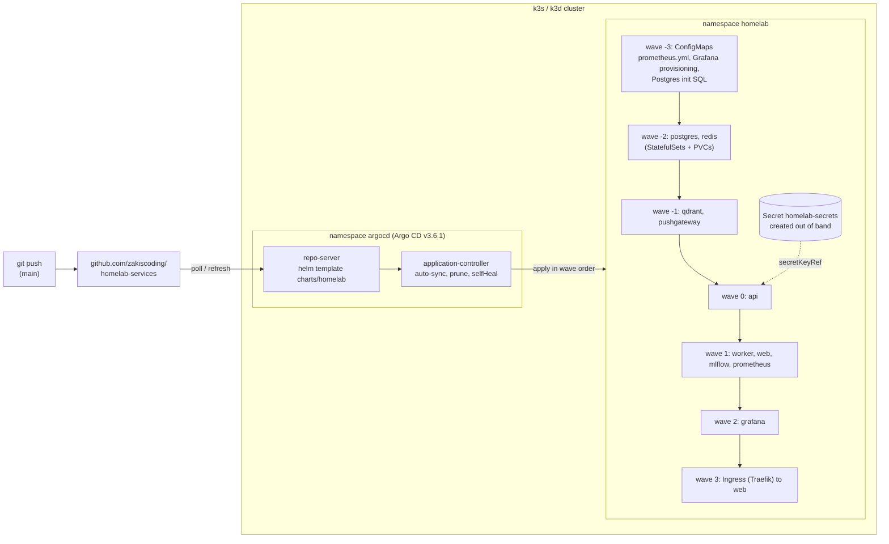

# GitOps: Helm chart + Argo CD

The stack can also run on Kubernetes: [`charts/homelab`](../charts) packages every compose
service, and [`argocd/`](../argocd) has Argo CD deploy it from this repo with automated sync,
prune and selfHeal.

**This is not a cutover.** Production is still `docker-compose.yml` on the iMac (Colima). The
homelab's k3s node (the GPU PC's Ubuntu boot) was offline while this was built, so everything
below was proven on a throwaway k3d cluster on a Windows laptop. See [Limits](#limits).

## Architecture



- **One Application, one chart.** `argocd/base/application.yaml` points at
  `charts/homelab` on `main`, with `automated: {prune: true, selfHeal: true}`,
  `CreateNamespace=true` and retry with backoff.
- **Sync waves** come from `argocd.argoproj.io/sync-wave` annotations in the chart
  (`values.yaml` → `syncWaves`). Argo CD applies a wave, waits until it is Healthy, then
  applies the next, so Postgres and Redis are up before the api starts. A plain `helm install`
  ignores the annotations; there the api's `wait-for-postgres` initContainer covers ordering.
- **AppProject `homelab`** allows one source repo, one destination namespace, and only the
  kinds the chart renders (ConfigMap, Service, PVC, Deployment, StatefulSet, Ingress, plus the
  Namespace). A chart change that tried to create a Role or a Secret would be refused.
- **Secrets stay out of git.** The chart only references `secrets.existingSecret`; the Secret
  is created from `.env` with kubectl. The AppProject ignores it as an orphan.
- **Argo CD itself** is installed from the pinned upstream manifest:
  `argocd/install/kustomization.yaml` (v3.6.1).

## Run it

On a cluster that can reach GitHub (the intended setup):

```bash
kubectl create namespace argocd
kubectl apply --server-side --force-conflicts -k argocd/install
kubectl create namespace homelab
kubectl -n homelab create secret generic homelab-secrets --from-env-file=.env
kubectl apply -k argocd/base
kubectl -n argocd get application homelab -w     # until Synced / Healthy
```

The api, worker and web images must be in a registry the cluster can pull from first (see
[charts/README.md](../charts/README.md#install)).

Local proof, end to end (needs only Docker, kubectl and the homelab-web checkout next to this
repo):

```bash
bash charts/test.sh          # lint, kubeconform, unit tests
bash charts/test-k3d.sh      # k3d cluster -> helm install -> Argo CD sync -> selfHeal -> delete
```

`test-k3d.sh` uses cluster name `hs-gitops` and host ports 18643 (API) and 18680 (ingress) so
it can share Docker with other clusters. Because the branch is tested before it is pushed,
`argocd/overlays/local-k3d` points the same Application at an in-cluster `git daemon` that
serves a bare clone of the branch (committed state only), at `targetRevision: helm-argocd`, and
adds `values-local.yaml`.

## Results

Measured on 2026-11-14 on a Windows 11 laptop, Docker Desktop 29.8 (WSL2, 8 CPUs, 31 GiB),
k3d 5.9.0 running k3s v1.36.6+k3s1 as a single node. Docker was shared with other workloads,
so build and pull times are noisy; the install and sync times are with images already on the
node.

### Static checks (`charts/test.sh`)

| Check | Result |
|-------|--------|
| Chart file copies vs repo config | 14 files in sync |
| `helm lint --strict` (Helm 4.3.2), 4 value sets | 4/4 passed, 0 warnings (one INFO: no chart icon) |
| `helm template` + `kubeconform -strict`, Kubernetes 1.36.6 schemas | 90 resources in 4 renders, 90 valid, 0 invalid, 0 skipped |
| helm-unittest 1.2.1 | 5 suites, 32 tests, 32 passed |
| Wall time | 2 min 10 s cold, 32 s with images and schemas cached |

The value sets are the defaults (28 objects), `values-local.yaml` (28), `ci/minimal-values.yaml`
(8) and `ci/all-enabled-values.yaml` (26: every component plus a custom StorageClass, TLS
hosts, pull secrets, a config override and some persistence switched off). The schema also
rejects `image.tag: latest`, an empty `secrets.existingSecret` and an unknown `LLM_BACKEND`;
the unit tests check the first two.

### Helm install on k3d (chart-testing style)

`helm install --wait` into a fresh namespace, then smoke checks, then `helm uninstall`.

| Measurement | Result |
|-------------|--------|
| `helm install --wait` | **61 s**, 10/10 pods Running and Ready |
| api `/health`, qdrant `/readyz`, prometheus, pushgateway, grafana, mlflow `/health` | all 200, under 15 ms |
| api `/health/gpu` | 200 in 17.3 s (the LLM backend probe; see below) |
| web `/` in-cluster / through the Traefik Ingress on :18680 | 200 in 17.2 s / 200 in 15.1 s |
| Prometheus targets | in-cluster jobs (prometheus, homelab-api, qdrant, pushgateway) all up |

The first attempt did not pass, and both causes are fixed or documented:

1. **PVCs stayed Pending for about 3.5 minutes.** k3s's local-path-provisioner was failing
   with `Unauthorized` against the API server (a cluster problem, not the chart). Restarting
   its pod fixed it. Not seen again.
2. **web never became Ready.** Its readiness probe was `GET /` with a 5 s timeout, and the home
   page waits on `api /health/gpu`, which took 17 s. The probe is now a TCP check.

### Argo CD on k3d

| Measurement | Result |
|-------------|--------|
| Argo CD v3.6.1 install until repo-server, server and controller are ready | 77 s |
| `kubectl apply -k argocd/overlays/local-k3d` until the Application is **Synced / Healthy** | **87 s**, synced to `helm-argocd` at the committed SHA |
| Pods | 10/10 Running and Ready, same smoke results as above |

Pod ages at that moment show the sync waves doing their job: postgres and redis 87 s, qdrant
and pushgateway 76 s, api 70 s, worker, web, mlflow and prometheus 57 s, grafana 31 s.

Spot checks after the sync: Grafana had provisioned all four dashboards (GopherGrid, GPU PC
(RTX 5070), Homelab ML Platform, Homelab Stack); Postgres had run the init SQL (11 tables in
`public`, plus the `mlflow` database). In the Helm run, the worker was polling the api and
getting `204` (no work) on `claim-imac`, so its `WORKER_API_KEY` from the Secret was accepted.

### selfHeal

Each change was made with kubectl behind Argo CD's back, then timed until git's state was back.
The controller log shows `Initiated automated sync` for each one.

| Drift | Reverted after | Back to serving |
|-------|----------------|-----------------|
| `kubectl scale deploy/api --replicas=0` | 2 s (`spec.replicas` back to 1) | api rolled out 13 s after the scale-down |
| `kubectl delete deploy/worker` | 2 s (Deployment recreated) | worker Ready 2 s after the delete (no readiness probe, image cached) |
| Hand-edit of ConfigMap `prometheus-config` | 5 s (restored from git) | |

Argo CD reacts to the watch event on the managed resource, so drift is fixed in seconds, not
at the 3-minute repo poll interval.

Deleting the Application (with its finalizer) removed every workload but kept the six PVCs:
four created by StatefulSet `volumeClaimTemplates` and the Grafana and MLflow claims, which are
annotated `Prune=false` and `helm.sh/resource-policy: keep`. The cluster was deleted afterward.

## Problems hit on the way

- **Downloaded tool binaries would not run.** Windows Application Control blocked the helm,
  k3d, argocd and kubeconform release `.exe` files. Every tool runs from its official container
  image instead (`alpine/helm`, `helmunittest/helm-unittest`, `ghcr.io/yannh/kubeconform`,
  `ghcr.io/k3d-io/k3d`, `quay.io/argoproj/argocd`); helm and the argocd CLI join the k3d
  Docker network and use a kubeconfig that points at the server container.
- **`alpine/git` has no `git daemon`** (it is a separate Alpine package), and git refused to
  serve a repo whose files were owned by the Windows uid. The test git server now installs
  `git-daemon` on `alpine:3.22` and extracts the repo as root.
- **CRLF.** This checkout converts to CRLF on Windows, which would have put `\r` into every
  ConfigMap. `charts/.gitattributes` forces LF and `sync-chart-files.sh` strips CRs, so a Windows
  checkout renders the same bytes as Argo CD's Linux clone.

## Limits

- **Not run on the real homelab cluster.** The k3s node on the GPU PC was offline. k3d is k3s
  in Docker, with the same Traefik and local-path storage, but one node on a laptop says
  nothing about that machine's disks, networking or GPU.
- **The production Application was not synced.** `argocd/base` targets GitHub `main`, which
  does not have this chart until the PR merges. Only the local overlay (same project and
  Application, different repo URL, branch and an extra values file) was exercised.
- **api, worker and web images are not published.** The test built them locally and imported
  them with `k3d image import`. The default tags in `values.yaml` (`homelab-api:0.8.0`, ...)
  are placeholders until a registry (for example GHCR) and CI push exist.
- **Nothing was disabled for the local test**, because no service in this repo needs a GPU:
  vLLM, Ollama and the reaction CNN run on the GPU PC and are reached over the tailnet. The
  laptop was on the tailnet, so pods could reach it through Docker Desktop: in the Argo CD run
  10 of 12 Prometheus targets were up, and the 2 down were one `gpu-pc-federate` and one
  `vllm` target (the GPU PC runs one boot at a time, so one of each pair is always down). On a cluster without Tailscale, chat, RAG answers
  and vision fail and those targets show down; `/health` and the rest of the stack do not
  depend on them.
- **Single replicas, local-path volumes, no backups.** The backup and migration scripts are
  written for compose (`docker exec`). Init SQL only runs on an empty volume.
- **Not ported from compose:** the public HTTPS Caddyfile (TLS and basic auth), and the
  cloudflared tunnel behind the public dashboards. The Ingress has no auth; keep it on the
  LAN/tailnet.
- **mlflow installs `psycopg2-binary` with pip at start**, exactly as in compose, so its pod
  needs PyPI access and takes longer to become ready.
- **One release per namespace**, because resources use the compose service names.
