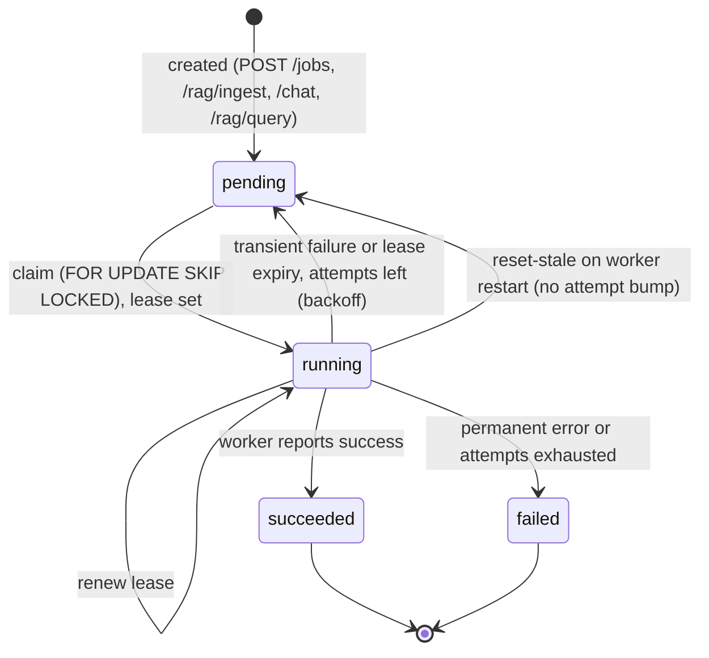
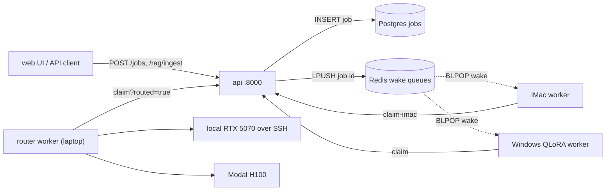
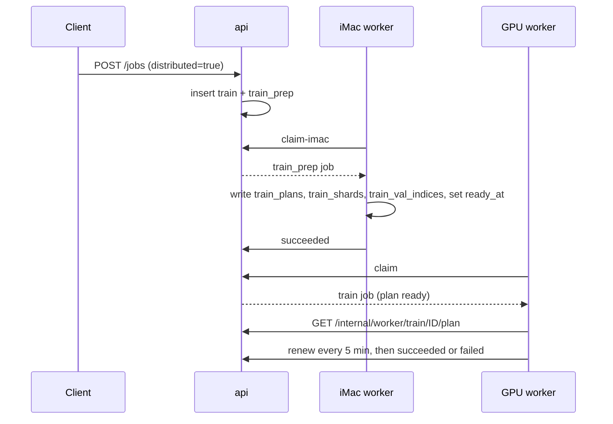

# Job queue

[homelab](https://github.com/zakiscoding/homelab) (docs hub) · **homelab-services** · [homelab-web](https://github.com/zakiscoding/homelab-web) · [homelab-gpu](https://github.com/zakiscoding/homelab-gpu) · [gpu-systems-lab](https://github.com/zakiscoding/gpu-systems-lab)

**Postgres is the single source of truth for every job. Workers claim over HTTP with leases, and Redis only wakes them up.** Back to [README](../README.md).

This page covers the design. Exact routes, payloads and error codes are in
[API.md](API.md#job-lifecycle). The code is `api/jobs.py` (queue), `api/job_notify.py` (wake
queues), `api/train_plan.py` (distributed plans) and `worker/poll_imac.py` (iMac worker).

## States

`infer` (`/chat`) and `rag_query` (`/rag/query`) rows are bookkeeping for synchronous requests.
The API runs them inline and they are never claimed or leased. If the API dies mid-request, the
lease sweep closes them as `inline_job_abandoned` after 10 minutes.

## Who claims what

| Type | Created by | Executed by | Claim route | Lease | Priority |
|------|-----------|-------------|-------------|-------|----------|
| `infer` | `POST /chat` | API, inline | none | none | 10 |
| `rag_query` | `POST /rag/query` | API, inline | none | none | 20 |
| `ingest` | `POST /rag/ingest` | iMac worker | `claim-imac` | 5 min | 30 |
| `train_prep` | `POST /jobs` with `distributed=true` | iMac worker | `claim-imac` | 5 min | 35 |
| `embed` | `POST /rag/ingest` (`auto_embed`) | iMac worker | `claim-imac` | 5 min | 40 |
| `train` | `POST /jobs` | Windows QLoRA worker ([homelab-gpu](https://github.com/zakiscoding/homelab-gpu)) | `claim` | 15 min | 50 |
| `train` with `payload.route` | `POST /jobs` with `route` | Router worker on the laptop ([gpu-systems-lab](https://github.com/zakiscoding/gpu-systems-lab)), runs on local RTX over SSH or Modal | `claim?routed=true` | 15 min | 50 |

## Rules

| Rule | Behavior |
|------|----------|
| Ordering | Lowest `priority` first, then oldest `created_at`. Only rows with `scheduled_at <= NOW()` are eligible. |
| Concurrency | At most one `train` running (routed or not) and at most one iMac job running. `SKIP LOCKED` keeps two claimers off one row. The one-at-a-time check is a `NOT EXISTS`, not a lock. |
| Leases | Claim sets `locked_by`, `lease_expires_at` and `started_at` (first claim). Workers renew with `POST /internal/worker/jobs/{id}/renew`: iMac worker every 2 min, QLoRA and router workers every 5 min. |
| Lease expiry | Swept on every claim of the same family and by `reset-stale`. Requeued like a transient failure, with `error_message = lease_expired`. |
| Retries | `max_attempts` defaults to 3. A failure retries only if it is transient and attempts remain. Backoff by attempt: 30 s, 120 s, then 600 s. |
| Worker restart | On startup a worker calls `reset-stale`, which returns its own `running` jobs to `pending` without bumping `attempt`. |
| Wake queues | New and requeued jobs `LPUSH` onto `homelab:jobs:wake:train` or `homelab:jobs:wake:imac`. A lost wake only delays a job until the next poll. Disable with `JOB_NOTIFY_ENABLED=false`. |
| Distributed train | A `distributed=true` train job is claimable only after its `train_prep` job has written a ready `train_plans` row. |
| Flags | `training_paused = "true"` makes `POST /jobs` return 503. `allow_infer_during_train = "true"` lets `/chat` run during a non-routed train job. |

## Distributed train flow

