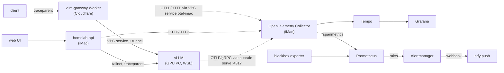

# Tracing, SLOs and alerting

[homelab-services](../README.md) / `docs/OBSERVABILITY-SLO.md` · [Operations](OPERATIONS.md) · [API](API.md)

The iMac's Prometheus and Grafana already collect the homelab's metrics. This adds three things:

1. **Distributed traces** across the request path, so one request can be followed from the public
   gateway or the web UI through the iMac API into vLLM on the GPU PC.
2. **SLOs** for the chat API and the gateway, with multiwindow burn-rate alerts.
3. **Alert delivery** (Alertmanager → ntfy push) and a direct alert for the failure that went
   unnoticed for 9 days in November: WSL down while Windows was up
   ([postmortem](https://github.com/zakiscoding/homelab/blob/main/docs/postmortems/2026-11-04-wsl-down.md)).



| Piece | Where | Notes |
|---|---|---|
| API tracing | [api/tracing.py](../api/tracing.py) | FastAPI server spans, httpx client spans with `traceparent`, `llm.backend` / `llm.model` attributes. Off unless `OTEL_EXPORTER_OTLP_ENDPOINT` is set |
| Gateway tracing | gpu-systems-lab `gateway/src/tracing.js` | W3C trace context in and out, OTLP/JSON exported after the response through a Workers VPC Service |
| vLLM tracing | gpu-systems-lab `serving/compose.yml` | `--otlp-traces-endpoint grpc://100.91.113.98:4317`; vLLM continues the incoming trace |
| Collector | [observability/otel-collector.yaml](../observability/otel-collector.yaml) | OTLP in; Tempo out; `spanmetrics` turns spans into request/latency series (the Worker has no `/metrics`) |
| Tempo | [observability/tempo.yaml](../observability/tempo.yaml) | single binary, 7 days, Grafana datasource `Tempo` |
| SLO rules | [prometheus/slo/gen_slo_rules.py](../prometheus/slo/gen_slo_rules.py) → `prometheus/config/rules/slo.yml` | generated from one table |
| Other alerts | [prometheus/config/rules/alerts.yml](../prometheus/config/rules/alerts.yml) | WSL down, GPU PC offline, gateway health, collector down, monitoring egress |
| Alertmanager | [observability/alertmanager.yml](../observability/alertmanager.yml) | webhook URL read from a file the sync script writes from `.env` |
| Rule tests | [prometheus/tests/alerts.test.yml](../prometheus/tests/alerts.test.yml) | `promtool test rules` |

Spans never carry prompts, completions or keys: the instrumentations don't record bodies, header
capture is off, the gateway records the client's key *name* only, and the collector deletes the usual
header and `gen_ai.prompt`/`gen_ai.completion` attributes in case a sender ever adds them. vLLM's
spans hold token counts and timings only (checked on a live span).

## SLOs

Error budget = 1 − target over 30 days. Each SLO alerts on burn rate over a long and a short window
together (Google SRE Workbook ch. 5): **page** at 14.4x over 1 h and 5 m, **page** at 6x over 6 h and
30 m, **ticket** at 1x over 3 d and 6 h.

| SLO | Target | SLI (bad events / all events) |
|---|---:|---|
| `chat-api-availability` | 99% | `/chat` responses with a 5xx |
| `chat-api-latency` | 95% | `/chat` responses slower than 15 s |
| `gateway-availability` | 99.5% | gateway server spans with a 5xx (from the Worker's own spans) |
| `gateway-chat-on-gpu` | 95% | gateway chat requests not answered by the GPU (Workers AI fallback) |
| `chat-on-gpu` | 95% | synthetic: probes of the API's `/health/gpu` where the backend isn't vLLM. Works with no user traffic |

The last two exist because the homelab degrades gracefully: during the November outage every chat
still got an answer, from a fallback model, so availability SLOs alone would have stayed green.

## Alerts

| Alert | Severity | Fires when |
|---|---|---|
| `SLOBurnRatePage` / `SLOBurnRateTicket` | page / ticket | an SLO burns its budget too fast (labels: `slo`, `burn`) |
| `GpuPcWslDown` | page | Windows boot reachable but vLLM on it down for 15 min: the November outage |
| `GpuPcLlmOffline` | ticket | no vLLM on either boot for 12 h (often intended: PC off) |
| `GatewayHealthDown` | page | public `/health` failing for 10 min |
| `MonitoringEgressDegraded` | ticket | the iMac's control probe fails; inhibits `GatewayHealthDown` |
| `TraceIntakeDown` | ticket | the collector is down, so gateway SLIs go quiet |

Inhibition: `GpuPcWslDown` suppresses the two chat-on-GPU SLO alerts (one cause, one page).

## Results (2026-11-14)

| Check | Result |
|---|---|
| API tracing tests (`pytest`, real local HTTP server as vLLM) | 6/6: one trace across server and client spans, `traceparent` reaches the LLM, incoming trace continued, no prompt or key in any span, `/health` untraced, off without an endpoint |
| Gateway tests (`node --test`) | 44/44, 13 of them new for tracing |
| `promtool test rules` | 9/9, including the November outage replayed: `GpuPcWslDown` silent at 5 min, firing at 16 min; silent when the PC is off or in its Ubuntu boot |
| `promtool check` / `amtool check-config` / collector `validate` | pass (6 + 45 rules) |
| Live trace, gateway → vLLM (gateway run with `wrangler dev` on the real remote VPC bindings) | one trace: gateway server span 789 ms → gateway client span `POST vllm` 622 ms → vLLM `llm_request` 60 ms (TTFT 32 ms). Most of the time is the dev Worker → tunnel → WSL hop, not the model |
| Live trace, deployed gateway → collector | a 401 span from production reached Tempo through VPC service `otel-imac` and tunnel `mos-imac` |
| Gateway latency with tracing on (40 requests each, unauthenticated `/v1/models`) | p50 113.7 → 110.0 ms, p95 139.5 → 134.8 ms: no measurable cost (export runs after the response) |
| vLLM restart with the OTLP flag | healthy after 252 s; chat used the fallbacks meanwhile |
| Alert delivery | real `SLOBurnRatePage` alerts arrived on the ntfy topic, formatted by ntfy's Alertmanager template |

### What the traces found on day one

The first traced `/chat` through the iMac API took 133 s and returned 502. Its trace had a single
client span: `POST http://100.88.71.33:11434/api/generate`, the **Ollama** fallback, not vLLM. Then:

- The API picks a backend by probing each endpoint once, with a 2 s timeout, every 30 s.
- From inside the iMac's Colima containers, connections to tailnet hosts often fail. Over 20 tries,
  6 succeeded, taking 1–4 s. From the macOS host, the same request succeeded 20/20 in about 20 ms.
- So the probe usually fails, the API falls back to Ollama, and Ollama on Windows times out.

Prometheus agreed: over the previous 3 hours its vLLM target on the Windows boot was up only 34% of
the time. The GPU window that evening explains about a third of that.

- Containers on the Colima VM also time out reaching the public internet. The VM itself does better,
  but not reliably: 2 of 4 HTTPS requests timed out. That matches the long-standing "registry pulls
  from the iMac time out" problem.
- ICMP from the VM is answered locally by Colima's user-mode network. Even the powered-off Ubuntu boot
  "replies" in 2 ms, so pings are useless as a liveness signal there.
- Windows' native ports (22, 11434) don't answer from the VM. Ports Windows exposes with
  `tailscale serve` (8000, 9090, 9102) do.

The fix is outside this change: it means reconfiguring or restarting Colima (for example vmnet
networking with `--network-address`), which takes every iMac service down. Meanwhile:

- The blackbox exporter runs on the VM's host network.
- A control probe raises `MonitoringEgressDegraded` and suppresses `GatewayHealthDown`, so the
  probing host's problems don't page as gateway outages.
- The `chat-on-gpu` page that is firing is correct: chat through the API really is on the broken fallback.

### Where the drops happen, and step 1 of the fix (2026-11-14)

The same test, 20 tries each with a 5 s timeout ("slow" = over 1 s), run while the GPU PC's vLLM was
stopped for a benchmark, so the tailnet targets are WSL Prometheus `:9090` and the laptop:

| From | Tailnet (GPU PC) | Tailnet (laptop) | Internet |
|---|---|---|---|
| macOS host | 20/20 | 20/20 | 20/20 |
| Colima VM | 19/20, 3 slow | 20/20, 1 slow | 17/20, 3 slow |
| Container, bridge network | 19/20, 2 slow | 18/20, 3 slow | 14/20, 8 slow |
| Container, host network | 18/20, 3 slow | 20/20 | 12/20, 11 slow |

The VM itself already loses connections, so this is Colima's user-mode network (`limactl usernet`,
a userspace NAT on macOS, up since 2026-10-23), not Docker's bridge. Host networking does not help.
The drop rate varies with load: earlier the same night containers reached the tailnet 6 times in 20.

**Step 1, no downtime: make the API tolerate it** ([api/llm.py](../api/llm.py)).

- Each backend check retries a dropped connection: 3 tries of 3 s each. An HTTP answer is final.
- Checks run in a background thread every 30 s, so requests read a cached choice and never wait on
  a check. The exception is the first request after an API restart, which runs the first check itself
  (about 18 s with the Ubuntu boot off).
- A working vLLM endpoint is kept until it fails two checks in a row.
- Ollama gets a 5 s connect and 60 s read timeout. A dead Ollama used to hold a chat for 133 s; with
  vLLM down, a chat now fails in 5.2 s with `Ollama unreachable`.
- If neither vLLM nor Ollama answers a check, stay on the last vLLM that worked. A dead Ollama can
  only fail, while a vLLM request may get through a slow connect.
- Cache vLLM's model list for 5 minutes, so a chat opens one connection instead of two.
- Tests script dropped connections, a hung Ollama and the fallback rules: 17/17 API tests pass.

| Measured with vLLM up (24 chats, 12 s apart) | Chats OK | Answered by | Failures |
|---|---:|---|---|
| Before (2026-11-14 02:30–02:45, 4 chats) | 0/4 | Ollama fallback, every time | 502 after 132–135 s |
| After the retry, background check and "stay on vLLM" rules (03:41–03:52) | 13/24 | vLLM, every time | 11 × 502: the chat's own connection to vLLM timed out (15 s), 1 × 140 s |

So the API now keeps chat on the GPU and fails fast, but on this network about half the chats still
fail, because the connection to vLLM itself drops. The client side can't fix that; the VM network has
to be fixed (steps 2 and 3).

The model-list cache landed after that run. Its own measurement (03:54–04:04) doesn't count: another
session stopped vLLM for a benchmark at 03:57. One more gap it showed: right after an API restart there
is no "last vLLM that worked" yet, so if the first check fails, chat goes to Ollama until a check
succeeds.

Still open: Colima itself. Step 2 is a test `colima restart` (fresh user-mode network, about 3–5 min
of iMac downtime). Step 3, if that doesn't hold, is switching to vmnet networking (`socket_vmnet`,
`network.address: true`). Both need a downtime window.

## Operate

```bash
# on the iMac, from the repo
docker-compose up -d otel-collector tempo alertmanager blackbox   # images: see docker-compose.yml
./scripts/sync-observability.sh       # copy configs in (Colima), restart, then prometheus.yml
python3 prometheus/slo/gen_slo_rules.py   # after editing the SLO table; commit both files
docker run --rm -v "$PWD/prometheus:/p" -w /p/tests --entrypoint promtool prom/prometheus:v3.5.0 test rules alerts.test.yml
```

- **Alerts to your phone:** `.env` holds `ALERT_WEBHOOK_URL=https://ntfy.sh/<topic>?template=alertmanager`.
  The topic name is the only secret. Subscribe to it in the ntfy app. Without the variable, alerts stay
  in the Alertmanager UI (`127.0.0.1:9093` on the iMac).
- **Find a trace:** every gateway response carries `x-trace-id`. Paste it into Grafana → Explore → Tempo.
- **Tailnet senders:** the iMac runs `tailscale serve --bg --tcp 4317 tcp://127.0.0.1:4317` for vLLM's
  OTLP/gRPC.
- **Pending:** `GpuPcWslDown` needs a Windows-native port that the Colima VM can reach. The plan is
  `tailscale serve --bg --tcp 2222 tcp://127.0.0.1:22` on the GPU PC's Windows boot; the probe already
  targets `100.88.71.33:2222`. Until then that probe fails, so the alert stays silent. The outage is
  still caught by the `chat-on-gpu` SLO, which pages within 30 minutes of a full fallback
  (the 6x/6 h rule; tested), and by `GpuPcLlmOffline`.
